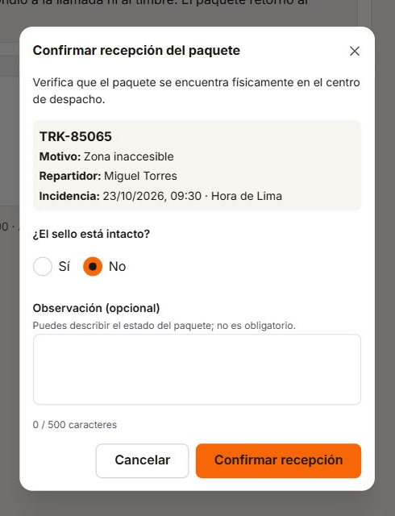

# ES-F04-03: recepción de paquetes en el frontend

Verificación: 24/10/2026. Rama: `feature/f04-recepcion-paquete-frontend`.

## Alcance y referencias

Implementación del formulario de recepción desde el listado y el detalle de F-04. Sigue [la especificación](../../G2-Despacho-Specs/especificaciones/ES-F04-03-ConfirmarRecepcionPaquete/spec.md), [su UI](../../G2-Despacho-Specs/especificaciones/ES-F04-03-ConfirmarRecepcionPaquete/ui.md) y [el contrato de Gestión](../../G2-Despacho-Specs/integraciones/api-contract-gestion-despachos.md#521-confirmar-recepción-en-centro--es-f04-03). Los formatos se mantienen en ese contrato canónico.

Se utiliza una composición local de Mantine Modal, Radio.Group y Textarea, con el tema existente. Los cambios están limitados al frontend administrativo de entregas fallidas. No se modifican componentes compartidos, otros módulos, servicios ni bases de datos.

## Comportamiento implementado

- Consulta el detalle vigente antes de permitir confirmar; no confía en la versión de una fila antigua.
- Presenta código operativo, motivo, repartidor y fecha de Lima.
- Sello Sí/No sin selección inicial; No y observación vacía son válidos. Recorta extremos y cuenta hasta 500 puntos de código Unicode, incluidos emojis.
- Envía únicamente los datos del contrato. Bloquea doble envío, edición y cierre durante la confirmación.
- Valida la respuesta aceptada antes de anunciar éxito; distingue recepción física de liberación de capacidad pendiente.
- Refresca la pantalla de origen conservando sus filtros y navegación. Un fallo de refresco conserva la recepción aceptada y bloquea decisiones desactualizadas.
- Conserva el formulario ante validación/rechazo recuperable. Un conflicto exige revisar el contexto.
- Ante resultado desconocido conserva la solicitud original incluso al cerrar/reabrir; exige consultar antes de ofrecer su repetición exacta. Una incidencia diferente no acredita el resultado original ni recibe automáticamente la decisión.
- Retira contenido protegido al perder autorización. Contiene el foco, etiqueta el cierre y devuelve el foco al disparador o al encabezado si aquel desaparece.

## Pruebas automatizadas

`npm run test:f04`: 32 pruebas aprobadas en cuatro archivos. Incluye 10 pruebas nuevas del modal y una integración nueva en cada pantalla; las restantes comprueban regresiones del listado, detalle y sesión.

Cobertura: contexto vigente, cuerpo/versiones, No sin observación, Unicode 500/501, doble activación, errores 400/500/503, conflicto 409, revocación 403, recuperación por consulta, repetición exacta tras reapertura, cambio de incidencia, refresco de indicadores/filtros y éxito conservado con refresco fallido. El caso integrado del detalle comprueba también el retorno del foco al encabezado cuando la acción queda bloqueada.

`npm run typecheck`: comprobación de los tres espacios de trabajo.

`npm run build -w @despacho/administrativo`: compilación administrativa. Vite advierte que el bundle principal supera 500 kB; la compilación finaliza correctamente.

Estas pruebas usan fixtures y transporte simulado; no son pruebas de integración con servicios desplegados.

## Revisión manual

Se verificó en el navegador la aplicación real con un servidor temporal y datos simulados identificados mediante un aviso visible:

- Apertura desde detalle y listado; selección No sin observación; respuesta 202 y actualización de recepción e indicadores.
- Filtro de pendientes conservado, retirando la fila recibida; retorno del foco al encabezado cuando desaparece el disparador. Al cancelar, el foco vuelve al botón de recepción.
- Foco inicial en el contexto, Tab desde sello hasta observación, Escape antes de enviar y reapertura sin selección heredada.
- Ancho efectivo de 390 × 844 píxeles CSS: modal de 351 píxeles sin desbordamiento horizontal, botones completos y principal debajo de Cancelar. Se restableció el tamaño del navegador al terminar.

La captura adjunta contiene únicamente datos simulados.

## Pendientes de integración

El backend correspondiente está guardado por separado en `31e1f6e` y no se modificó en este incremento. Falta ejecutar el recorrido conjunto con Gateway, autenticación y servicios reales, incluyendo la actualización efectiva del historial y la liberación de capacidad en Operación. La revisión formal al 200 % de ampliación y la revisión de diseño prevista con Max quedan pendientes. Este registro no declara completitud conjunta de la especificación ni modifica su aprobación.
